# ゲームの見た目をよくするあれこれ

3Dシーンの「Unityっぽさ」を減らすための調整

---

## 導入

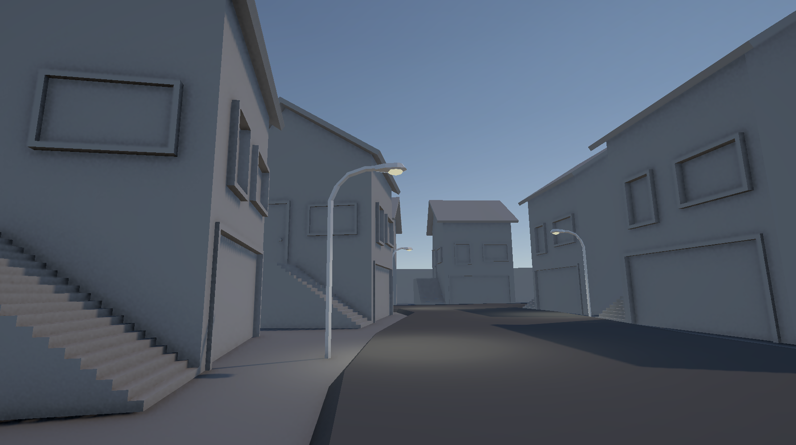

ゲームを作ってみたはいいものの見た目がしっくりこない
よく見るグラフィックになる

---

## マテリアル

BlenderのマテリアルのRoughnessの初期値は **0.5**。そのまま全素材へ使うと、表面の質感が似通いやすい。

素材ごとに反射の広がりを決める。金属、塗装、コンクリートを同じ値にしない。

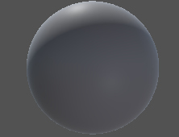

---

## フォグ

遠い場所ほど霧を強めると、建物が空気になじみ、奥行きが出る。

**変更前**　　　　　　　　　　　　　　　 **変更後**

 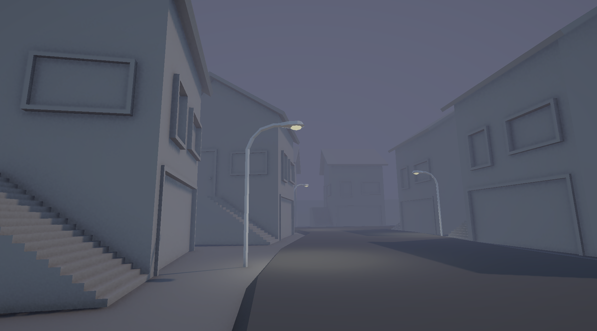

---

## フォグの設定方法

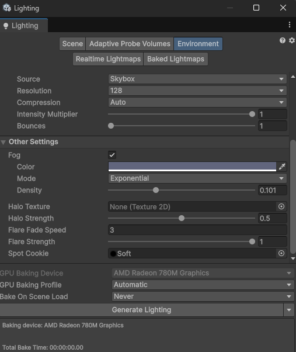

Lighting → Environment → Other Settings の **Fog** をオンにする。

Fogの色、Mode、Densityをシーンに合わせて調整する。

---

## フォグと背景色

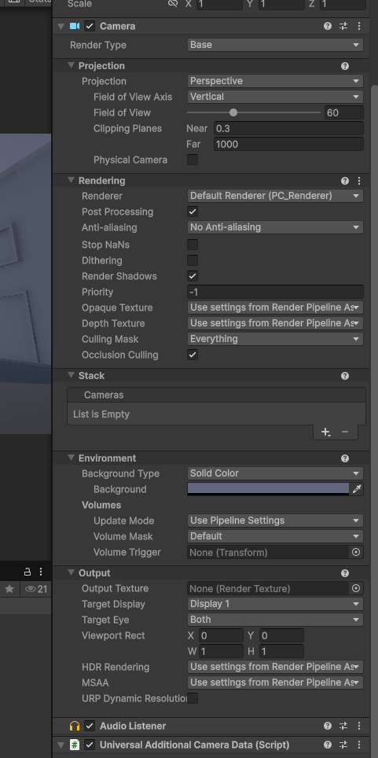

**Skyboxにはフォグが適用されない**ため、遠景と空の色が合わないことがある。

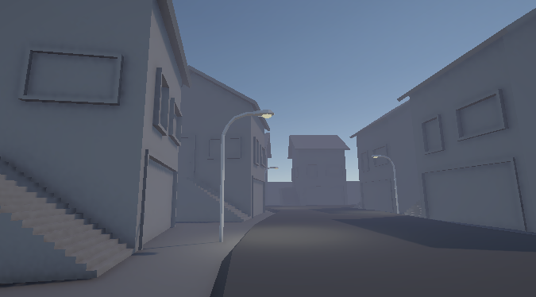

Main Camera の Inspector で **Environment → Background Type** を **Solid Color** に変更する。

**Background** にフォグと近い色を設定し、空と遠景の境目を確認する。

---

## Bloom

明るい部分の周囲に光のにじみを作る。

**変更前**　　　　　　　　　　　　　　　 **変更後**

 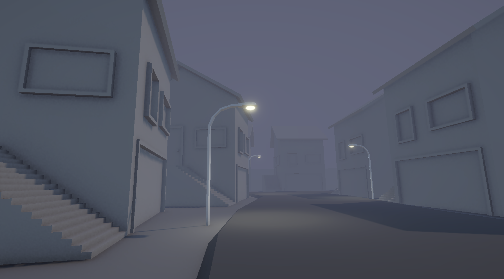

**Threshold** は反応する明るさの境界、**Intensity** はにじみの強さ。

---

## Bloomの設定方法

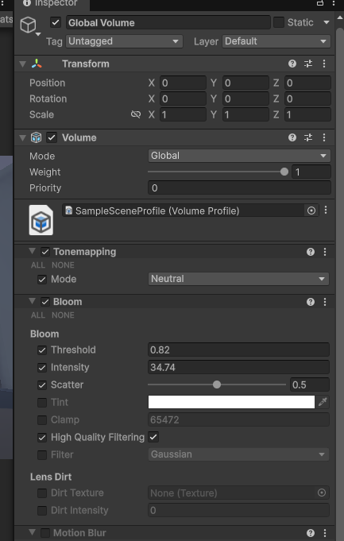

Hierarchyで **Global Volume** を選び、Inspectorの Bloom を開く。

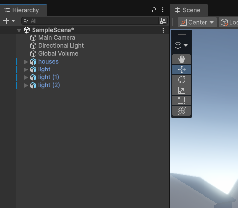

Thresholdで街灯だけが主に反応するようにし、Intensityを調整する。

---

## Bloomが強すぎる例

**控えめ**　　　　　　　　　　　　　　　 **強すぎる例**

 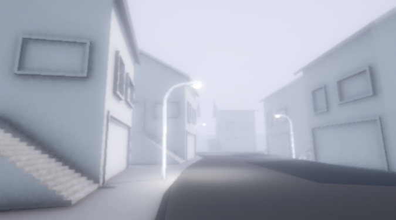

しきい値が低すぎると街全体が白くなる。光源以外もにじむ場合はThresholdを上げる。

---

## ACESの効果

HDRをSDRに変換するトーンマッピング。明るい部分と暗い部分の印象が変わる。

**Neutral**　　　　　　　　　　　　　　 **ACES**

 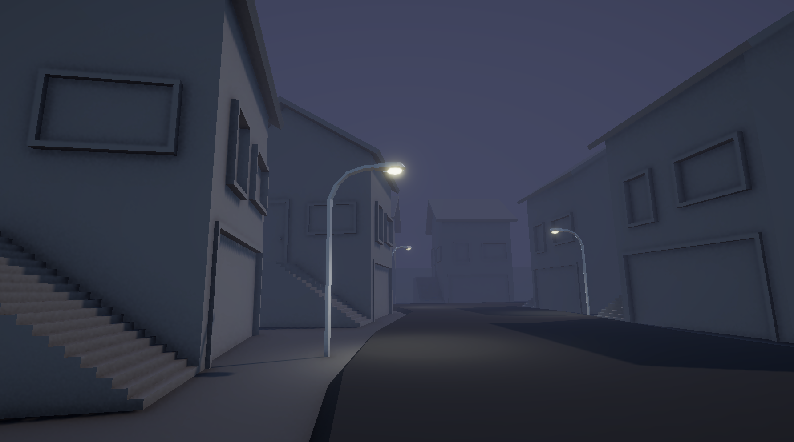

---

## ACESの設定方法

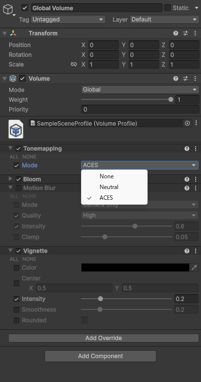

Global Volume の **Tonemapping** を Neutral から ACES に変更する。

街灯と暗部の見え方を比較して確認する。

---

## 環境光を暗くした結果

ライトを消しても、Skybox由来の環境光は残る。

**変更前**　　　　　　　　　　　　　　　 **変更後**

 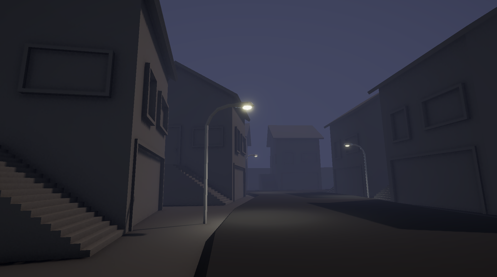

建物と道路が暗くなり、街灯が目立つ。

---

## 環境光を暗くする設定方法

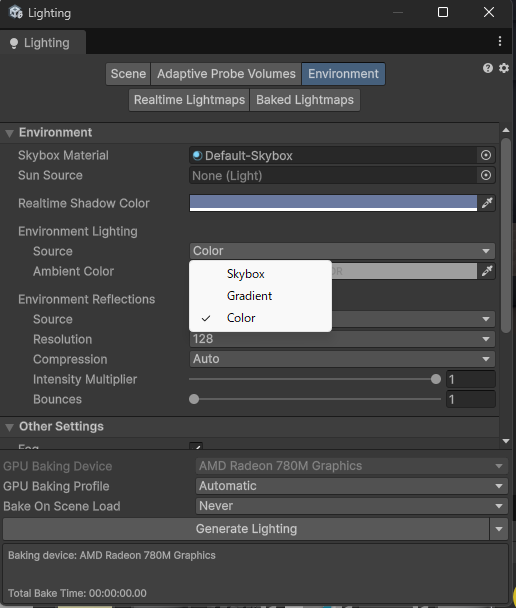

Lighting → Environment で **Environment Lighting** の Source を Color に変更し、Ambient Colorを暗くする。

---

## まとめ

---

# 良きゲ制ライフを

~Thank you for listening~
